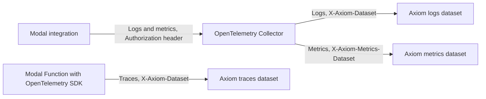

import ReplaceDomain from "@/content/snippets/replace-domain.mdx"
import ReplaceToken from "@/content/snippets/replace-token.mdx"

[Modal](https://modal.com) is a serverless platform for running AI inference, training, and batch jobs on GPUs. This page explains how to send two kinds of Modal telemetry to Axiom:

- **Platform telemetry:** The [Modal OpenTelemetry integration](https://modal.com/docs/guide/otel-integration) exports Modal audit logs, Function logs, and container metrics such as GPU utilization, GPU memory usage, and cold start time. Send this data to Axiom through an OpenTelemetry Collector. For more information, see [Send logs and metrics through a Collector](#send-logs-and-metrics-through-a-collector).
- **Traces from your code:** The Modal integration doesn’t create traces. To see how long model loading and each inference call take, instrument your Modal Functions with the OpenTelemetry SDK and send traces directly to Axiom. For more information, see [Send traces from Modal Functions](#send-traces-from-modal-functions).

## Why the Modal integration needs a Collector

Axiom routes OpenTelemetry data to datasets with request headers:

- Logs and traces use the `X-Axiom-Dataset` header.
- Metrics use the `X-Axiom-Metrics-Dataset` header, and they go to a separate dataset of the metrics type.

The Modal integration sends all signals to one endpoint with one set of headers. You define the headers in a Modal Secret with one key per header, named `OTEL_HEADER_` followed by the header name. Modal Secret key names contain only letters, digits, and underscores, so a key name can’t contain the hyphens in `X-Axiom-Dataset` or `X-Axiom-Metrics-Dataset`. For more information, see the Modal documentation on [OpenTelemetry integration](https://modal.com/docs/guide/otel-integration) and [Secret limits](https://modal.com/docs/guide/secrets).

As a result, the Modal integration can’t send the Axiom dataset headers, and Axiom can’t route its data to a dataset. An OpenTelemetry Collector solves this problem. Modal authenticates to the Collector with an `Authorization` header, which is a valid Secret key name. The Collector then forwards each signal to the right Axiom dataset with the right headers.



## Prerequisites

- [Create an Axiom account](https://app.axiom.co/register).
- [Create three datasets in Axiom](/reference/datasets#create-dataset): one for logs and one for traces with the **Events** type, and one for metrics with the **Metrics** type.
- [Create an API token in Axiom](/reference/tokens) with permissions to ingest data to the three datasets.
- [Create a Modal account](https://modal.com/signup) and [install the Modal Python package](https://modal.com/docs/guide).
- To send platform telemetry, prepare a host for the OpenTelemetry Collector that Modal can reach over HTTPS from the internet.

## Send logs and metrics through a Collector

<Steps>
<Step title="Configure the Collector">

Install the [OpenTelemetry Collector Contrib distribution](https://opentelemetry.io/docs/collector/installation/). It includes the `bearertokenauth` extension that the configuration below uses.

Create a Collector configuration file with the following content:

```yaml otel-collector-config.yaml
extensions:
  # Accept requests only from Modal
  bearertokenauth:
    scheme: Bearer
    token: ${env:COLLECTOR_TOKEN}

receivers:
  otlp:
    protocols:
      http:
        endpoint: 0.0.0.0:4318
        tls:
          cert_file: /etc/otelcol-contrib/tls/cert.pem
          key_file: /etc/otelcol-contrib/tls/key.pem
        auth:
          authenticator: bearertokenauth

processors:
  batch:
    send_batch_max_size: 8192

exporters:
  otlphttp/axiom-logs:
    compression: zstd
    endpoint: https://AXIOM_DOMAIN
    headers:
      authorization: Bearer ${env:AXIOM_API_TOKEN}
      x-axiom-dataset: LOGS_DATASET_NAME
  otlphttp/axiom-traces:
    compression: zstd
    endpoint: https://AXIOM_DOMAIN
    headers:
      authorization: Bearer ${env:AXIOM_API_TOKEN}
      x-axiom-dataset: TRACES_DATASET_NAME
  otlphttp/axiom-metrics:
    compression: zstd
    endpoint: https://AXIOM_DOMAIN
    headers:
      authorization: Bearer ${env:AXIOM_API_TOKEN}
      x-axiom-metrics-dataset: METRICS_DATASET_NAME

service:
  extensions: [bearertokenauth]
  pipelines:
    logs:
      receivers: [otlp]
      processors: [batch]
      exporters: [otlphttp/axiom-logs]
    traces:
      receivers: [otlp]
      processors: [batch]
      exporters: [otlphttp/axiom-traces]
    metrics:
      receivers: [otlp]
      processors: [batch]
      exporters: [otlphttp/axiom-metrics]
```

<Info>
<ReplaceDomain />
Replace `LOGS_DATASET_NAME`, `TRACES_DATASET_NAME`, and `METRICS_DATASET_NAME` with the names of the Axiom datasets for logs, traces, and metrics.

Replace the paths in `cert_file` and `key_file` with the paths to the TLS certificate and private key for the host name of the Collector. If a load balancer or reverse proxy terminates TLS in front of the Collector, remove the `tls` section.
</Info>

The `traces` pipeline handles spans that reach the Collector through the Modal integration. For more information, see [Send custom spans and metrics through Modal](#send-custom-spans-and-metrics-through-modal).

</Step>
<Step title="Start the Collector">

Generate a random token that Modal uses to authenticate to the Collector. For example, run `openssl rand -hex 32`.

Start the Collector with the following environment variables:

- `COLLECTOR_TOKEN`: The random token you have generated.
- `AXIOM_API_TOKEN`: The Axiom API token you have generated.

```bash
COLLECTOR_TOKEN=COLLECTOR_TOKEN AXIOM_API_TOKEN=API_TOKEN \
  otelcol-contrib --config=otel-collector-config.yaml
```

<Info>
Replace `COLLECTOR_TOKEN` with the random token you have generated.

<ReplaceToken />
</Info>

The Collector listens for OTLP over HTTP on port 4318 and rejects requests without the correct token.

</Step>
<Step title="Create a Modal Secret">

Create a Modal Secret named `modal-otel-collector` that contains the `Authorization` header Modal sends to the Collector:

```bash
modal secret create modal-otel-collector 'OTEL_HEADER_Authorization=Bearer COLLECTOR_TOKEN'
```

<Info>
Replace `COLLECTOR_TOKEN` with the random token you have generated.
</Info>

Alternatively, create the Secret in the [Modal dashboard](https://modal.com/secrets) with `OTEL_HEADER_Authorization` as the key and `Bearer COLLECTOR_TOKEN` as the value.

</Step>
<Step title="Configure the Modal integration">

1. In Modal, go to the [metrics settings page](https://modal.com/settings/metrics).
1. In the OpenTelemetry push URL, enter the base URL of the Collector, for example `https://otel.example.com:4318`. Don’t add a signal path such as `/v1/logs`. Modal adds the path for each signal.
1. Select the `modal-otel-collector` Secret.
1. Save your changes, and then use the test button.

In Axiom, the logs dataset receives a `Hello from Modal! 🚀` log from the `modal.test_logs` service. After your Modal Functions run, the logs dataset receives Function logs and audit logs, and the metrics dataset receives container metrics such as `modal.gpu.compute.utilization` and `modal.input_events.coldstart_time_us`. For the full list of metrics and their tags, see the [Modal documentation](https://modal.com/docs/guide/otel-integration#metrics).

</Step>
</Steps>

### Send only logs

The Modal integration has no setting that turns off metrics export. To keep logs and discard metrics, send the metrics pipeline to the `nop` exporter. The Collector then accepts metrics from Modal and doesn’t forward them to Axiom.

```yaml
exporters:
  nop:
  # Keep the otlphttp/axiom-logs and otlphttp/axiom-traces exporters

service:
  pipelines:
    metrics:
      receivers: [otlp]
      processors: [batch]
      exporters: [nop]
```

## Send traces from Modal Functions

AI workloads on Modal spend time in places that logs and container metrics don’t break down: loading model weights during a cold start, waiting on the GPU, and generating tokens. Traces show each of these steps. The example below runs in a Modal Function and sends traces directly to Axiom with the OpenTelemetry SDK for Python. It doesn’t depend on the Modal integration or the Collector.

<Steps>
<Step title="Create a Modal Secret for the SDK">

The OpenTelemetry SDK reads its exporter configuration from environment variables. Modal exposes the keys of a Secret as environment variables in the container. Secret key names that only contain letters, digits, and underscores are valid, and the header names in the values can contain hyphens.

Create a Modal Secret named `axiom-otel`:

```bash
modal secret create axiom-otel \
  OTEL_EXPORTER_OTLP_TRACES_ENDPOINT=https://AXIOM_DOMAIN/v1/traces \
  'OTEL_EXPORTER_OTLP_TRACES_HEADERS=Authorization=Bearer API_TOKEN,X-Axiom-Dataset=TRACES_DATASET_NAME'
```

<Info>
<ReplaceDomain />
<ReplaceToken />
Replace `TRACES_DATASET_NAME` with the name of the Axiom dataset for traces.
</Info>

</Step>
<Step title="Instrument a Modal Function">

Create a file named `traced_inference.py` with the following content:

```python traced_inference.py
import os

import modal

app = modal.App("traced-inference")

image = modal.Image.debian_slim().pip_install(
    "opentelemetry-sdk",
    "opentelemetry-exporter-otlp-proto-http",
)

MODEL_NAME = "MODEL_NAME"


@app.cls(
    gpu="H100",
    image=image,
    secrets=[modal.Secret.from_name("axiom-otel")],
)
class Model:
    @modal.enter()
    def setup(self):
        from opentelemetry import trace
        from opentelemetry.exporter.otlp.proto.http.trace_exporter import OTLPSpanExporter
        from opentelemetry.sdk.resources import Resource
        from opentelemetry.sdk.trace import TracerProvider
        from opentelemetry.sdk.trace.export import BatchSpanProcessor

        # Identify the Modal container and environment that produce each span
        resource = Resource.create({
            "service.name": "traced-inference",
            "service.instance.id": os.environ.get("MODAL_TASK_ID", "local"),
            "deployment.environment.name": os.environ.get("MODAL_ENVIRONMENT", "local"),
        })

        # The exporter reads the endpoint and headers from the axiom-otel Secret
        self.provider = TracerProvider(resource=resource)
        self.provider.add_span_processor(BatchSpanProcessor(OTLPSpanExporter()))
        trace.set_tracer_provider(self.provider)
        self.tracer = trace.get_tracer("traced-inference")

        # Measure the cold-start cost of loading the model
        with self.tracer.start_as_current_span("load_model"):
            self.model = load_model()

    @modal.method()
    def generate(self, prompt: str) -> str:
        with self.tracer.start_as_current_span(f"chat {MODEL_NAME}") as span:
            span.set_attribute("gen_ai.operation.name", "chat")
            span.set_attribute("gen_ai.provider.name", "PROVIDER_NAME")
            span.set_attribute("gen_ai.request.model", MODEL_NAME)

            output, input_tokens, output_tokens = run_model(self.model, prompt)

            span.set_attribute("gen_ai.usage.input_tokens", input_tokens)
            span.set_attribute("gen_ai.usage.output_tokens", output_tokens)
            return output

    @modal.exit()
    def shutdown(self):
        # Export buffered spans before the container stops
        self.provider.shutdown()


def load_model():
    # Replace with the code that loads your model onto the GPU
    return None


def run_model(model, prompt):
    # Replace with your inference code. Return the output and the token counts.
    return f"Echo: {prompt}", len(prompt.split()), 2


@app.local_entrypoint()
def main():
    print(Model().generate.remote("Hello from Modal"))
```

<Info>
Replace `MODEL_NAME` with the name of the model, and `PROVIDER_NAME` with the provider or serving framework of the model.

Replace `load_model` and `run_model` with your own code. Change `gpu="H100"` to the GPU type your model needs.
</Info>

The example uses the following Modal features:

- The `@modal.enter()` method runs once when a container starts. It configures the tracer provider and records model loading in a `load_model` span, so cold starts are visible in each container’s first trace.
- The `@modal.method()` method records each inference call in a `chat MODEL_NAME` span with the `gen_ai.*` attributes that Axiom uses for its AI trace views.
- The `@modal.exit()` method exports buffered spans before the container stops. Modal gives exit handlers a grace period of 30 seconds. For more information, see the Modal documentation on [container lifecycle hooks](https://modal.com/docs/guide/lifecycle-functions).
- The `MODAL_TASK_ID` and `MODAL_ENVIRONMENT` environment variables identify the container and the Modal environment. For more information, see the Modal documentation on [environment variables](https://modal.com/docs/guide/environment_variables).

If you instrument a plain `@app.function` instead of a class, call `trace.get_tracer_provider().force_flush()` before the function returns. Modal lifecycle hooks are only available on classes.

</Step>
<Step title="Run the Function">

Run the following command in your terminal:

```bash
modal run traced_inference.py
```

In Axiom, the traces dataset receives a `load_model` span and a `chat MODEL_NAME` span. The `chat` span carries the `gen_ai.*` attributes, so Axiom shows the trace in its AI trace views.

</Step>
</Steps>

For more information on the attributes of AI spans and how Axiom displays them, see the following:

- [LLM observability](/use-cases/llm-observability)
- [Manual instrumentation](/use-cases/llm-observability/manual-instrumentation)
- [Generative AI attributes](/use-cases/llm-observability/gen-ai-attributes)

### Send custom spans and metrics through Modal

Modal offers custom metrics and spans as a beta feature that you enable by contacting Modal. With this feature, the OpenTelemetry SDK in your Function sends data to a collector inside Modal, and the Modal integration forwards it with the rest of your platform telemetry. If you set up the Collector above, custom spans go to the traces dataset and custom metrics go to the metrics dataset. For the required environment variables, see the [Modal documentation](https://modal.com/docs/guide/otel-integration#custom-metrics).

Use either this feature or the `axiom-otel` Secret for a Function, not both, so that each span reaches Axiom once.

## Limitations

- Modal Secret key names can’t contain hyphens, so the Modal integration can’t send the Axiom dataset headers. To send platform telemetry to Axiom, route it through an OpenTelemetry Collector.
- The Modal integration doesn’t create traces. To trace your workloads, instrument your code with the OpenTelemetry SDK.
- The Collector must be reachable from Modal over the internet. Protect it with the bearer token and TLS as shown above.

## What’s next

- [Send OpenTelemetry data to Axiom](/send-data/opentelemetry)
- [Query traces](/query-data/traces)
- [Query metrics](/query-data/metrics)
